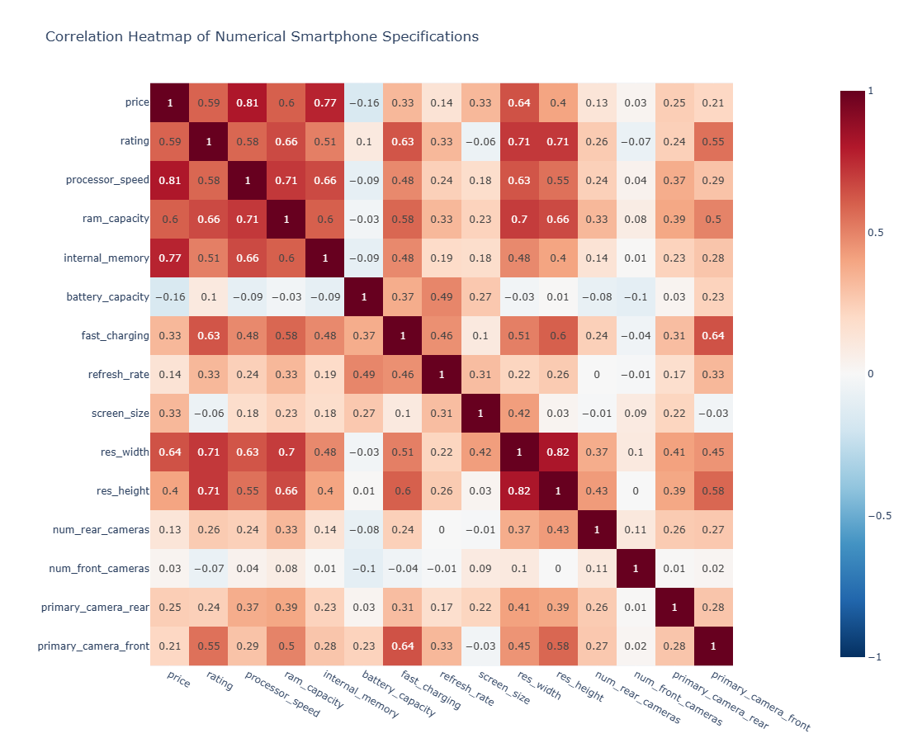
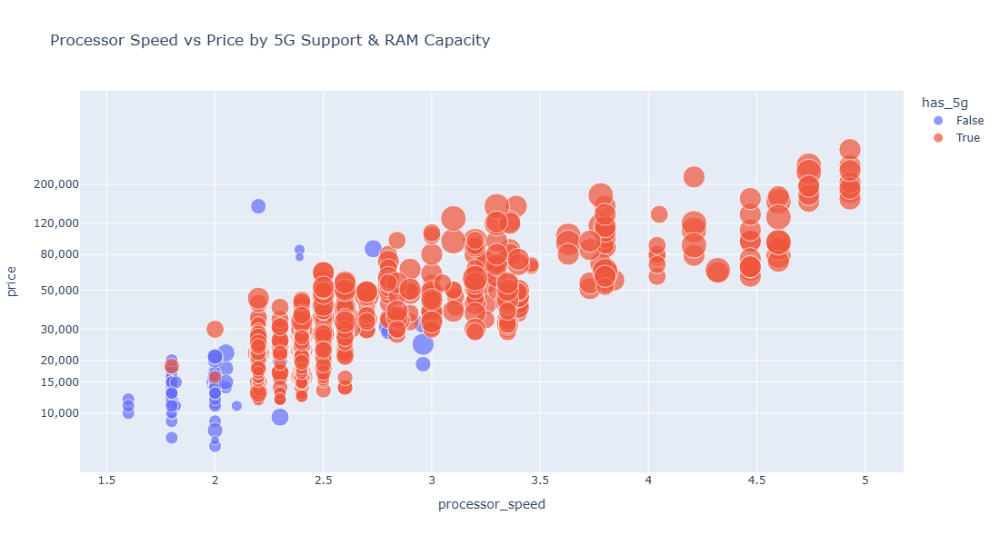

# 📱 Are Expensive Smartphones Actually Worth It? (MobilePrix Data Analysis)

An end-to-end data collection, cleaning, Exploratory Data Analysis (EDA), and ML-ready preprocessing pipeline built on **800+ Indian smartphones** scraped from **MobilePrix**—ranging from budget phones under ₹10,000 all the way up to **₹4,49,900** (Apple iPhone Duo 2TB).

## 🎯 Project Objective
Ultra-premium and foldable smartphones in India now reach up to **₹4,49,900**, yet core hardware specs often plateau well below that price tier. This project investigates **where smartphone specs hit diminishing returns** and prepares a clean, leakage-free dataset ready for predictive modeling.

## 📊 Key Visual Insights

### 1. What Actually Drives Smartphone Prices?

* **Strongest Price Drivers:** `processor_speed` (`r = 0.81`) and `internal_memory` (`r = 0.77`) show the strongest positive correlation with `price`, followed by display resolution width (`r = 0.64`) and `ram_capacity` (`r = 0.60`)[cite: 4].
* **Specs That Don't Increase Price:** `battery_capacity` (`r = -0.16`) and `num_front_cameras` (`r = 0.03`) have virtually zero—or slightly negative—correlation with price, proving larger batteries are actually more common in budget and mid-range phones than flagships.

### 2. Processor Speed, 5G Adoption & RAM Scaling Across Price Tiers

* **5G Is No Longer a Premium Feature:** Non-5G devices (`has_5g = False`) cluster almost entirely below ₹20,000, while 5G becomes standard across the ₹15,000–₹35,000 mid-range segment[cite: 5].
* **Diminishing Returns Above ₹35,000:** Between ₹25,000 and ₹35,000, buyers already unlock high-clock-speed octa-core processors (`2.5–3.3 GHz`) and generous RAM capacities, while ultra-expensive tiers push prices sharply upward for incremental clock gains.

## 🔄 Pipeline & Methodology
1. **Web Scraping (`01_mobileprix_web_scraping.ipynb` & `src/scraping_data.py`):** Automated extraction of raw smartphone listings and spec sheets from MobilePrix.
2. **Data Cleaning & Feature Engineering (`02_Data_cleaning_smartphone_1`,`03_Data_cleaning_smartphone_v2.ipynb`):**
   - Parsed unstructured spec strings into numeric features (`processor_speed`, `ram_capacity`, `internal_memory`, `battery_capacity`, `fast_charging`, `refresh_rate`, camera megapixels, and connectivity flags like `has_5g` and `has_foldable`).
   - Engineered **Pixel Density (`ppi`)** and **Value Score (`value_score`)** (`rating / (price / 10000)`).
3. **Exploratory Data Analysis (`04_Univariate_Analysis_of_smartphone_data.ipynb`, `05_Bivariate_Analysis_with_filling_Null_values_and_OHT.ipynb`):**
   - Conducted univariate, bivariate, and multivariate analysis across OS ecosystems (Android vs. iOS), pricing tiers, and brand positioning.
4. **Missing Value Imputation & Encoding:**
   - Filled structural feature absences with `0` and imputed true missing values using **brand/processor-level hierarchical medians** followed by scaled **`KNNImputer`**.
   - Applied leakage-free **`OneHotEncoder`** (`handle_unknown='ignore'`) on categorical features (`brand_name`, `processor_brand`, `os`).

## 🛠️ Languages & Tech Stack


* **Programming Language:** Python 3, Regular Expressions (Regex)
* **Web Scraping & HTML Parsing:** Selenium, BeautifulSoup4 (`bs4`)
* **Data Manipulation & Analysis:** Pandas, NumPy
* **Data Visualization:** Plotly Express, Matplotlib, Seaborn
* **Preprocessing & Imputation:** Scikit-Learn (`KNNImputer`, `StandardScaler`, `OneHotEncoder`)
* **Environment & Tools:** Jupyter Notebook, VS Code, Git & GitHub

## 📂 Repository Structure
```text
mobileprix-smartphone-analysis/
├── data/
│   ├── raw/                  # Original scraped HTML and raw CSV
│   └── processed/            # Cleaned and preprocessed datasets
├── images/                   # Exported Plotly EDA charts for README
├── notebooks/                # Step-by-step Jupyter Notebooks (01 to 04)
├── src/                      # Python web scraping script
├── .gitignore
├── requirements.txt
└── README.md
